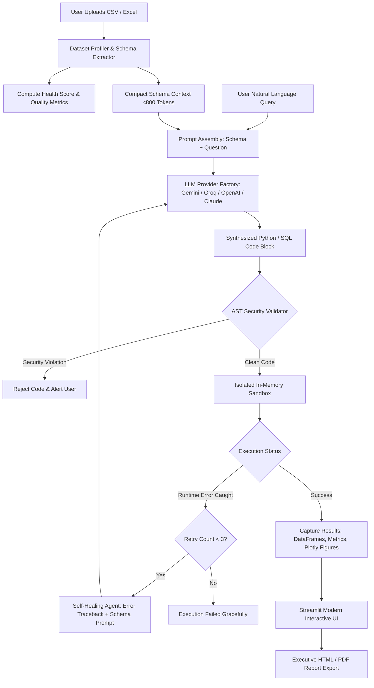

# PROJECT SYNOPSIS
## Conversational Data Analysis Assistant — Natural-Language Q&A Over Tabular Datasets

---

### 1. Project Information
- **Project Title:** Conversational Data Analysis Assistant: Natural-Language Q&A over CSV/Excel Datasets Using Autonomous Code Generation and Isolated Sandboxed Execution
- **Domain:** Artificial Intelligence, Natural Language Processing, Large Language Models (LLMs), Data Science & Cyber-Security Sandboxing
- **Target Degree:** Bachelor of Technology / Bachelor of Engineering in Computer Science & Engineering (or Information Technology / AI & Data Science)
- **Academic Year:** Final Year Major Project

---

### 2. Introduction & Background
The volume of tabular data generated by modern enterprises in spreadsheets (CSV, Excel) has surged exponentially. However, extracting actionable insights, statistical aggregations, and visual charts from these datasets typically requires specialized knowledge of programming languages such as Python (Pandas, NumPy, Matplotlib) or database query languages (SQL). Non-technical stakeholders, business analysts, clinicians, and researchers frequently encounter a technical barrier when interrogating complex datasets.

Recent advancements in Large Language Models (LLMs) offer unprecedented natural language reasoning. However, naively inputting entire tabular files into an LLM context window causes severe problems:
1. **Context Window Saturation & Exorbitant Token Costs:** Large datasets (>1,000 rows) exceed token limits and incur excessive API costs.
2. **Data Privacy & Compliance Violations:** Uploading entire customer, medical, or financial records to cloud LLM servers violates GDPR, HIPAA, and corporate confidentiality regulations.
3. **Hallucination in Numerical Calculations:** LLMs are autoregressive text predictors and frequently hallucinate exact sums, standard deviations, and complex aggregations when computing mentally without an execution engine.

This project introduces a **Program Synthesis & Isolated Sandboxing paradigm**: instead of asking the LLM to directly calculate and output numerical results, the LLM is provided only with a **compact, token-safe schema** to synthesize deterministic Python Pandas / Plotly or DuckDB SQL code. This code is then executed in a local, AST-guarded isolated sandbox, returning mathematically verifiable tables, charts, and statistics.

---

### 3. Problem Statement
*"To design, develop, and evaluate an enterprise-grade conversational data analysis system that accepts arbitrary CSV/Excel datasets, translates natural-language user queries into executable Python/SQL code using token-safe schema prompting, safely executes the synthesized code in an AST-inspected execution sandbox to generate interactive charts and statistical tables, and autonomously recovers from runtime exceptions through a self-healing retry loop."*

---

### 4. Objectives of the Project
1. **Zero-Data-Leakage Schema Extraction:** Design an intelligent metadata extractor that captures column names, data types, missing percentages, numerical distributions, and top categorical values within fewer than 800 tokens without transmitting raw dataset rows.
2. **Multi-Model LLM Code Synthesis:** Implement a provider-agnostic LLM interface supporting state-of-the-art models including Google Gemini (Gemini 3.8 Flash), Groq (Llama-3.3-70b), OpenAI (GPT-4o/mini), Anthropic Claude 3.5 Sonnet, and Local Ollama.
3. **AST-Guarded Sandboxed Execution:** Engineer a pre-runtime Abstract Syntax Tree (AST) security scanner that inspects generated code and strictly blocks prohibited operations (e.g., `os`, `sys`, `subprocess`, file writing, network calls, dynamic code evaluation) before executing code in memory.
4. **Dual Query Engine Support:** Provide seamless procedural analysis via **Pandas & Plotly** and declarative relational querying via **DuckDB ANSI SQL**.
5. **Autonomous Error Self-Correction Loop:** Develop an automated feedback agent loop that intercepts Python runtime exceptions (`KeyError`, `AttributeError`, `TypeError`), formulates diagnostic repair prompts, and heals erroneous code up to 3 cycles without human intervention.
6. **Automated Exploratory Data Analysis & Health Scoring:** Implement an algorithm that computes a 0–100% Data Quality Score, missing value distribution reports, Pearson correlation heatmaps, and dynamic question recommendations.
7. **Executive Reporting:** Provide one-click generation of comprehensive, publication-ready HTML/PDF analytical reports containing interactive visualizations, data tables, and an auditable code log.

---

### 5. Existing System vs. Proposed System

| Parameter | Traditional BI Tools (Tableau, PowerBI) | Naive LLM Chat (ChatGPT Free) | Proposed Conversational Assistant |
|---|---|---|---|
| **Query Mechanism** | Drag-and-drop / DAX formulas | Plain Natural Language text | Natural Language with smart prompt suggestions |
| **Privacy & Security** | Data stored on server | Raw dataset sent to cloud | **Token-safe Schema only**; raw data never leaves client |
| **Calculation Accuracy** | Deterministic (High) | Prone to arithmetic hallucination | **Deterministic (100% accurate Python execution)** |
| **Runtime Resilience** | Static error dialogs | Regenerates whole response blindly | **Autonomous Self-Healing Loop** (Traceback diagnosis) |
| **Execution Safety** | Pre-configured engine | No local execution | **AST Static Security Sandbox** (Blocks malicious code) |
| **Database Capability** | Complex database configuration | None | **Zero-setup in-memory DuckDB ANSI SQL** |
| **Cost & Token Footprint**| Expensive licenses | Millions of tokens for large files | **< 800 tokens per query** (Schema metadata only) |

---

### 6. System Architecture & Workflow

---

### 7. Hardware & Software Requirements

#### Hardware Requirements:
- **Processor:** Intel Core i3 / AMD Ryzen 3 or higher (Intel Core i5 / Apple Silicon recommended)
- **RAM:** Minimum 4 GB (8 GB or higher recommended for datasets > 100,000 rows)
- **Storage:** 500 MB free hard drive space
- **Network:** Active internet connection for Cloud LLM APIs (Offline local mode supported via Ollama)

#### Software Requirements:
- **Operating System:** Windows 10/11, macOS (Monterey+), or Linux (Ubuntu 20.04+)
- **Programming Language:** Python 3.10+ (Tested on Python 3.14)
- **Web Application Framework:** Streamlit 1.30+
- **Data Manipulation & SQL:** Pandas 2.0+, NumPy 1.24+, DuckDB 0.9+
- **Data Visualization:** Plotly Express 5.18+, Matplotlib 3.7+, Seaborn 0.12+
- **AI / LLM SDKs:** `google-genai`, `openai`, `anthropic`, `requests`
- **Security & Inspection:** Python standard library `ast`, `contextlib`, `io`
- **Document & Reporting:** Jinja2, Tabulate, python-pptx

---

### 8. Feasibility Analysis
- **Technical Feasibility:** The project utilizes mature, industry-standard open-source libraries (Pandas, Streamlit, DuckDB) and modern, highly stable Cloud LLM APIs. The AST module is native to Python, ensuring zero external overhead for security.
- **Economic Feasibility:** Passing only metadata schemas reduces API token consumption by over 95% compared to raw file ingestion. Free-tier API keys from Groq and Google Gemini allow deployment and continuous testing at zero operating cost.
- **Operational Feasibility:** The user interface requires zero programming knowledge. Users simply upload a file and type questions in plain English or click pre-computed prompt suggestions.

---

### 9. Expected Outcomes & Real-World Impact
1. Enables non-technical users in business, healthcare, and education to perform complex data exploratory analyses in seconds.
2. Guarantees 100% calculation accuracy by offloading arithmetic to Python Pandas instead of relying on stochastic LLM generation.
3. Provides an enterprise-ready template for securely sandboxing LLM-generated code.
4. Produces an automated executive reporting suite for immediate academic, executive, and regulatory presentation.
