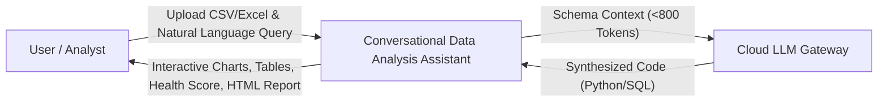
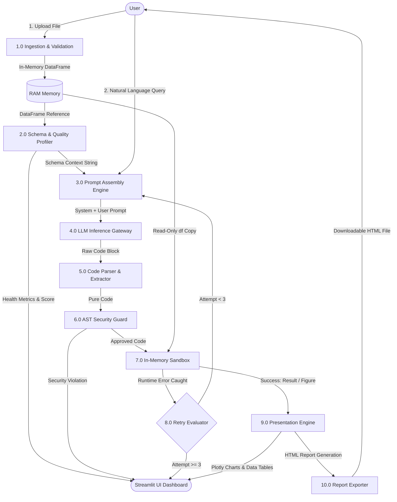
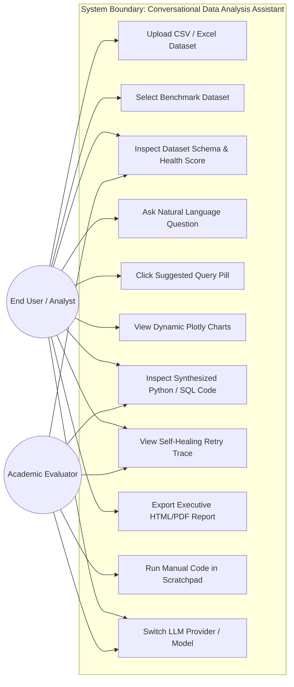

# SOFTWARE REQUIREMENTS SPECIFICATION (SRS)
## Conversational Data Analysis Assistant — Natural-Language Q&A Over Tabular Datasets
**Standard: IEEE Std 830-1998 Compliant**

---

## 1. Introduction

### 1.1 Purpose
This Software Requirements Specification (SRS) document provides a formal, comprehensive description of the software architecture, functional capabilities, non-functional constraints, external interface behaviors, and validation models for the **Conversational Data Analysis Assistant**. This document serves as the primary technical specification for developers, project evaluators, software quality assurance engineers, and academic examiners.

### 1.2 Document Conventions
- **Shall:** Mandatory requirement that must be fulfilled by the system.
- **Should:** Highly recommended capability that is implemented in the primary baseline.
- **May:** Optional or future enhancement.
- Requirements are tagged with unique alphanumeric identifiers (e.g., `FR-01` for Functional Requirements, `NFR-01` for Non-Functional Requirements).

### 1.3 Intended Audience & Reading Suggestions
This document is structured for:
- **Academic Evaluators & Project Guides:** Reviewing Sections 1, 2, and 6 for architecture, design trade-offs, and behavioral modeling.
- **Software Engineers & Developers:** Implementing or extending modules specified in Sections 3, 4, and 5.
- **Security & Quality Auditors:** Evaluating the AST security sandbox and compliance protocols in Sections 4.5 and 5.2.

### 1.4 Product Scope
The Conversational Data Analysis Assistant is an autonomous, web-based analytical platform designed to bridge the technical barrier between non-programmers and tabular datasets. The system converts human conversational language into verified Python Pandas or DuckDB ANSI SQL scripts, executes these scripts in an isolated memory namespace subjected to Abstract Syntax Tree (AST) security inspection, recovers autonomously from execution faults via an iterative self-correction loop, and renders interactive WebGL/Plotly charts, data slices, and downloadable executive reports.

### 1.5 References
1. IEEE Std 830-1998: *IEEE Recommended Practice for Software Requirements Specifications*.
2. Python Software Foundation: *The Abstract Syntax Tree (ast) Module Documentation*.
3. DuckDB Foundation: *In-Process Analytical Database Specification*.
4. Google Cloud AI: *Gemini API and google-genai Python SDK Documentation*.
5. Streamlit Inc.: *Streamlit Component Architecture and Reactive Execution Model*.

---

## 2. Overall Description

### 2.1 Product Perspective
The system operates as an intelligent middleware layer situated between the end-user, cloud LLM inference endpoints, and local in-memory analytical compute engines. Unlike traditional cloud analytics platforms that mandate transmitting raw data records to external infrastructure, this product enforces a **zero-data-leakage client-side execution model**. Only structural schema summaries are transmitted across network boundaries.

```
+-------------------------------------------------------------------------+
|                              END USER CLIENT                            |
|  +--------------------+     +----------------------------------------+  |
|  | Local CSV/XLSX File|     | Streamlit Web Browser Dashboard        |  |
|  +---------+----------+     +-------------------+--------------------+  |
|            |                                    |                       |
|            v                                    v                       |
|  +--------------------+             +-----------+------------+          |
|  | In-Memory DataFrame|             | User Natural Lang Q&A  |          |
|  +---------+----------+             +-----------+------------+          |
|            |                                    |                       |
|            v                                    v                       |
|  +--------------------+             +-----------+------------+          |
|  | Schema Extractor   | ----------> | Prompt Assembly Module |          |
|  | (< 800 Tokens)     |             +-----------+------------+          |
|  +--------------------+                         |                       |
+-------------------------------------------------|-----------------------+
                                                  | Schema + Query
                                                  v
                                     +------------+------------+
                                     | Cloud LLM API Gateway   |
                                     | (Gemini / Groq / OpenAI)|
                                     +------------+------------+
                                                  |
                                                  | Generated Python / SQL
                                                  v
+-------------------------------------------------------------------------+
|                     ISOLATED LOCAL SECURITY SANDBOX                     |
|  +--------------------+     +----------------------------------------+  |
|  | AST Security Guard | --> | Safe Execution Namespace (df, pd, px)  |  |
|  +--------------------+     +-------------------+--------------------+  |
|                                                 |                       |
|                                                 v                       |
|                                     +-----------+------------+          |
|                                     | Result (Plotly / Table)|          |
|                                     +------------------------+          |
+-------------------------------------------------------------------------+
```

### 2.2 Product Functions
1. **Multi-Format Tabular Ingestion:** Parses comma-separated values (`.csv`) and Microsoft Excel (`.xlsx`, `.xls`) workbooks into Pandas DataFrames.
2. **Schema & Statistical Introspection:** Extracts column names, data types, null percentages, statistical min/max/mean, and top categorical frequency distributions.
3. **Multi-Model LLM Code Generation:** Translates user questions into validated Python or SQL queries via Google Gemini, Groq, OpenAI, Anthropic Claude, or local Ollama.
4. **AST Pre-Execution Security Guard:** Intercepts system calls, file system writes, process spawning, and dunder reflections prior to execution.
5. **Sandboxed Code Execution:** Executes verified code on in-memory data, capturing tables, metrics, and Plotly charts.
6. **Autonomous Error Self-Correction Loop:** Catches execution tracebacks and autonomously prompts the LLM to heal bugs up to 3 cycles.
7. **Automated Exploratory Data Analysis:** Calculates a 0–100% Data Health Scorecard, missing value distribution tables, and Pearson correlation matrices.
8. **Executive Report Generation:** Compiles session history, figures, tables, and audit logs into standalone downloadable HTML documents.

### 2.3 User Classes and Characteristics
- **Business & Financial Analysts:** Require rapid summary metrics, KPIs, and charts without writing Python scripts.
- **Academic Evaluators & Researchers:** Evaluate algorithmic correctness, AST security sandboxing, token optimization, and data hygiene.
- **Domain Experts (Doctors, Educators):** Query patient or student datasets without understanding database schemas.

### 2.4 Operating Environment
- **Client Tier:** Any modern HTML5/WebGL compliant browser (Chrome 90+, Edge 90+, Firefox 88+, Safari 14+).
- **Application Server Tier:** Python 3.10 through 3.14 on Windows, macOS, or Linux.
- **Memory Consumption:** Baseline 250 MB RAM; scales linearly with uploaded dataset size.

### 2.5 Design and Implementation Constraints
- **C-1 (Memory Limit):** Datasets must fit entirely in available system RAM (in-memory compute paradigm).
- **C-2 (Security Constraint):** Under no circumstance shall the execution engine permit calls to `os`, `sys`, `subprocess`, `open`, or `eval`.
- **C-3 (Timeout Constraint):** Any query script executing longer than 15 seconds shall be terminated to prevent resource starvation.
- **C-4 (Token Constraint):** Schema context must stay within an 800-token budget to enable free-tier API compatibility.

---

## 3. External Interface Requirements

### 3.1 User Interfaces
- **UI-1:** The user interface shall provide a responsive multi-tab layout consisting of:
  - Tab 1: Conversational Q&A with clickable prompt suggestions and chat history.
  - Tab 2: Automated EDA, Health Scorecard, Missing Values, and Correlation Heatmap.
  - Tab 3: Raw Dataset Inspector and manual Python Sandbox Scratchpad.
  - Tab 4: Executive Report Export with live preview and download triggers.
  - Tab 5: Academic Viva Defense and System Architecture documentation.
- **UI-2:** The sidebar shall provide controls for LLM provider selection, model configuration, API key input (masked), dataset selection/upload, query engine toggling (Pandas vs. DuckDB SQL), and maximum retry configuration.

### 3.2 Software Interfaces
- **SI-1 (Pandas 2.0+):** Core data frame manipulation, vectorized filtering, and aggregation.
- **SI-2 (DuckDB 0.9+):** In-memory OLAP SQL engine registering DataFrames as virtual tables (`dataset`, `data`, `df`).
- **SI-3 (Plotly Express 5.18+):** Generation of interactive WebGL/SVG charts.
- **SI-4 (Google Gemini API):** Cloud inference using the official `google-genai` SDK with `gemini-3.8-flash`.
- **SI-5 (OpenAI API / Groq Cloud):** Inference via standard OpenAI-compatible REST endpoints.

---

## 4. Functional Requirements

### 4.1 Data Ingestion & Validation
- **FR-01.1:** The system shall accept `.csv`, `.xlsx`, and `.xls` files up to 200 MB.
- **FR-01.2:** The system shall provide at least four built-in benchmark datasets (E-Commerce, Healthcare, Academic Performance, Tech Stocks) for immediate zero-upload testing.
- **FR-01.3:** If file parsing fails due to encoding or corrupted headers, a clean, descriptive error message shall be surfaced to the user.

### 4.2 Privacy-Safe Schema Extraction
- **FR-02.1:** The system shall extract column names, data types, null counts, null percentages, and unique cardinality for every column.
- **FR-02.2:** For numerical dimensions, the system shall compute Min, Max, Mean, and Median.
- **FR-02.3:** For categorical dimensions, the system shall extract the top 5 most frequent string values.
- **FR-02.4:** The system shall format the extracted metadata and the first 3 sample rows into a Markdown table not exceeding 800 tokens.
- **FR-02.5:** Under no circumstances shall raw rows beyond the first 3 sample rows be transmitted to the LLM.

### 4.3 AI Code Generation Pipeline
- **FR-03.1:** The system shall combine the dataset schema and the user's natural language question into a structured system prompt.
- **FR-03.2:** The prompt shall instruct the LLM to store data results in variable `result` and visualization figures in variable `fig`.
- **FR-03.3:** The system shall support a dual engine mode:
  - Procedural Python (Pandas + Plotly)
  - Declarative SQL (DuckDB ANSI SQL)
- **FR-03.4:** The system shall extract executable code blocks from markdown fences (````python ... ```` or ````sql ... ````).

### 4.4 AST Pre-Execution Security Validator
- **FR-04.1:** Prior to execution, generated code shall be parsed into a Python Abstract Syntax Tree (`ast.parse`).
- **FR-04.2:** The validator shall traverse all nodes and reject any script containing:
  - Banned module imports: `os`, `sys`, `subprocess`, `shutil`, `socket`, `urllib`, `requests`, `ctypes`, `winreg`.
  - Banned builtin calls: `open`, `eval`, `exec`, `compile`, `__import__`, `globals`, `locals`, `input`, `breakpoint`.
  - Reflection and dunder exploits: `__subclasses__`, `__globals__`, `__code__`, `__bases__`.
- **FR-04.3:** If a security violation is detected, the script shall immediately abort and return a `SecurityViolationError` without calling `exec()`.

### 4.5 Sandboxed Execution & Artifact Capture
- **FR-05.1:** Execution shall run in an isolated dictionary scope containing only whitelisted globals (`pd`, `np`, `plt`, `px`, `go`, `sns`, `df`) and safe builtins.
- **FR-05.2:** The system shall redirect `sys.stdout` to capture any printed outputs.
- **FR-05.3:** If an interactive Plotly figure is assigned to `fig`, the system shall extract it and flag `result_type = "chart_plotly"`.
- **FR-05.4:** If a Matplotlib figure is created, the system shall extract it and flag `result_type = "chart_matplotlib"`.
- **FR-05.5:** If a DataFrame or Series is produced, the system shall extract it and flag `result_type = "dataframe"`.

### 4.6 Autonomous Self-Healing Retry Loop
- **FR-06.1:** If sandbox execution raises an exception (`KeyError`, `AttributeError`, `TypeError`, `ZeroDivisionError`), the exception type, message, and failed code shall be intercepted.
- **FR-06.2:** The system shall formulate a specialized diagnostic repair prompt containing:
  - The previous failed code block
  - The exact exception name and error message
  - The dataset schema reminder
  - The original user question
- **FR-06.3:** The repair prompt shall be sent to the LLM to request corrected code.
- **FR-06.4:** The retry loop shall execute up to a configurable maximum limit (default: 3 iterations).
- **FR-06.5:** Upon successful resolution on attempt 2 or 3, the UI shall display an `Auto-Corrected on Attempt N` badge detailing the resolution history.

### 4.7 Automated Data Profiling & Health Assessment
- **FR-07.1:** The system shall calculate a Data Quality Score (0–100%) subtracting weighted penalties for missing values, duplicate rows, zero-variance columns, and malformed column names.
- **FR-07.2:** The system shall generate a sortable missing values table detailing counts and percentages.
- **FR-07.3:** The system shall generate a Pearson correlation heatmap for all numerical features.
- **FR-07.4:** The system shall dynamically generate 5 contextual query suggestions based on detected column types.

### 4.8 Executive Report Export
- **FR-08.1:** The system shall compile all conversational interactions, charts, data previews, and dataset health scores into a standalone HTML file.
- **FR-08.2:** The HTML report shall embed Plotly charts and base64-encoded images so that it renders completely offline without external web dependencies.
- **FR-08.3:** The report shall be styled for clean printing to PDF format.

---

## 5. Non-Functional Requirements

### 5.1 Performance Requirements
- **NFR-01 (Inference Latency):** LLM code generation should complete in under 3.0 seconds using modern cloud endpoints (Gemini 3.8 Flash, Groq).
- **NFR-02 (Execution Latency):** In-memory sandbox execution on datasets under 100,000 rows shall execute in under 500 milliseconds.
- **NFR-03 (Token Efficiency):** Prompt schema context shall not exceed 800 tokens.

### 5.2 Security & Safety Requirements
- **NFR-04 (RCE Immunity):** The system shall guarantee complete prevention of Remote Code Execution through multi-layer defense: AST pre-validation + isolated execution namespace + safe import wrapper.
- **NFR-05 (Data Confidentiality):** Under no circumstance shall customer record data rows be stored on disk or transmitted across network boundaries.
- **NFR-06 (API Key Privacy):** API keys entered in the user interface shall remain in session state memory and shall never be written to persistent log files.

### 5.3 Reliability & Fault Tolerance
- **NFR-07 (Graceful Degradation):** If an LLM endpoint returns a 404 or rate-limit error, the system shall attempt automatic model fallback or prompt the user with diagnostic recommendations.
- **NFR-08 (Zero Crash Guarantee):** Unhandled Python runtime errors in generated scripts shall never cause the web server process to terminate.

---

## 6. System Modeling & Diagrams

### 6.1 Data Flow Diagram (DFD Level 0 - Context Level)


### 6.2 Data Flow Diagram (DFD Level 1 - Detailed Functional Decomposition)


### 6.3 Use Case Diagram


### 6.4 Sequence Diagram (Query Execution & Self-Healing Flow)
```mermaid
sequenceDiagram
    autonumber
    actor User as User
    participant UI as Streamlit UI
    participant SE as Schema Extractor
    participant LLM as LLM Provider (Gemini/Groq)
    participant AST as AST Security Guard
    participant Box as Sandbox Execution Engine

    User->>UI: Types "Show sales by region as a bar chart"
    UI->>SE: Request Schema Metadata Context
    SE-->>UI: Returns schema (< 800 tokens)
    UI->>LLM: Send System Prompt(Schema) + Question
    LLM-->>UI: Return synthesized code: fig = px.bar(df, ...)
    UI->>AST: Inspect code AST tree
    AST-->>UI: Security Check PASSED (No banned calls)
    UI->>Box: Execute code in sandboxed namespace
    
    alt Execution Successful
        Box-->>UI: Returns Plotly Figure + Summary Table
        UI-->>User: Renders interactive chart & insights
    else Runtime Error (e.g. KeyError: 'sales')
        Box-->>UI: Catches KeyError: 'sales'
        UI->>LLM: Self-Healing Prompt(Code, Error, Schema)
        LLM-->>UI: Return repaired code: fig = px.bar(df, x='Region', y='Sales')
        UI->>AST: Re-verify repaired code AST
        AST-->>UI: Security Check PASSED
        UI->>Box: Re-execute repaired code
        Box-->>UI: Success on Attempt 2
        UI-->>User: Renders chart + "✨ Auto-Corrected on Attempt 2" Badge
    end
```

---

## 7. Requirement Traceability Matrix (RTM)

| Requirement ID | Description | Source Code Module | Test Case Reference | Status |
|---|---|---|---|---|
| **FR-01** | Dataset Ingestion (.csv, .xlsx) | `app.py`, `src/config.py` | Manual UI Test | **PASSED** |
| **FR-02** | Token-safe Schema Extraction | `src/engine/schema.py` | `tests/test_schema.py` | **PASSED** |
| **FR-03** | Prompt Assembly & System Prompt | `src/config.py`, `src/engine/self_healing.py` | `tests/test_self_healing.py` | **PASSED** |
| **FR-04** | Multi-Model LLM Integration | `src/llm/` (Gemini, Groq, OpenAI, Claude) | `tests/test_self_healing.py` | **PASSED** |
| **FR-05** | AST Pre-Execution Security | `src/engine/sandbox.py` | `tests/test_sandbox.py` | **PASSED** |
| **FR-06** | In-Memory Sandbox Execution | `src/engine/sandbox.py` | `tests/test_sandbox.py` | **PASSED** |
| **FR-07** | Autonomous Self-Healing Loop | `src/engine/self_healing.py` | `tests/test_self_healing.py` | **PASSED** |
| **FR-08** | In-Memory DuckDB ANSI SQL | `src/engine/sql_engine.py` | `tests/test_sql_engine.py` | **PASSED** |
| **FR-09** | Deep Profiling & Health Score | `src/engine/data_profiler.py` | Unit & UI Test | **PASSED** |
| **FR-10** | Interactive Plotly Charts | `src/engine/sandbox.py`, `src/ui/components.py` | `tests/test_sandbox.py` | **PASSED** |
| **FR-11** | Executive HTML Report Export | `src/ui/export_report.py` | Export Verification | **PASSED** |
